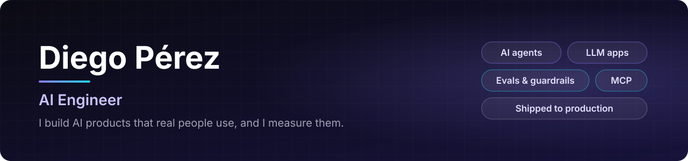

  

  
  
  
  

## 👋 About me

I'm an **AI Engineer** who designs, builds and ships AI-powered products end to end: requirements, architecture, LLM integration, evaluation and deployment.

- 💼 **Now:** AI Engineer at BeAI Now, owning client-facing AI applications: full-stack products, multi-agent LLM workflows, document AI and production delivery.
- 🛡️ **Before:** cybersecurity support (IndraMind). Higher Technician in Computer Network Systems Management (ASIR).
- 🧭 **How I build:** AI where it measurably helps, deterministic logic everywhere else, and real users as the bar. Not demos that only work in a notebook.

---

## 🚀 Featured projects

### 🏠 [RentIA](https://github.com/diegoperezg7/rentia-case-study) &nbsp;
**Rental management for Spanish landlords, running in production with real users.**

LAU contracts, IPC/IRAV rent updates, receipts, passed-on bills, expenses, IRPF (Modelo 100) and document OCR, with AI on local models. Self-hosted with CI/CD and used every month.

> **Why I built it:** the paperwork around a few rental properties is tedious and error-prone, and existing tools are either generic or send your documents to someone else's cloud. *Code is private; the case study covers product, architecture and decisions.*

`FastAPI` `React` `PostgreSQL` `Ollama` `OCR` `Docker`

 

<table>
<tr>
<td width="50%" valign="top">

### ✅ [Signoff](https://github.com/diegoperezg7/signoff)
**Prove what was agreed, built, verified and accepted, with governed AI agents.**

Software delivery assurance: from the client agreement to a signed-off acceptance, with requirements, change control, verification and evidence. **8 governed AI agents** with finite plans, allow-listed tools, resumable runs and human approval for every write.

> **Why:** most delivery disputes come from scope nobody can prove.

`FastAPI` `Next.js` `PostgreSQL` `Redis` `Agents`

</td>
<td width="50%" valign="top">

### 🧭 [ragcompass](https://github.com/diegoperezg7/ragcompass)
**Point it at your documents and get a benchmarked RAG configuration.**

Every recommendation comes with its reason and its evidence: parser per format (OCR and vision for scans), chunking measured on your own files, a retrieval benchmark (BM25, dense, hybrid) with confidence intervals, top-k, index size and cost, plus ready-to-paste LangChain, LlamaIndex and Haystack code. CLI, web app, API and MCP server.

> **Why:** "how should I configure this RAG?" is usually answered by guesswork.

`Python` `FastAPI` `React` `RAG` `MCP` `Embeddings`

</td>
</tr>
<tr>
<td width="50%" valign="top">

### 🧪 [evalsmith-mcp](https://github.com/diegoperezg7/evalsmith-mcp)
**Evaluate agent tool calls, prompt changes and retrieval, and fail CI when quality drops.**

**MCP server and CLI** with deterministic metrics: recall@k, MRR and nDCG for retrieval, strict or lax tool-call matching for agents, and golden-set checks for prompts. JUnit and SARIF-friendly reports, no paid keys.

> **Why:** ragcompass recommends a configuration; evalsmith proves whether it holds up.

`TypeScript` `MCP` `Evaluation` `CI`

</td>
<td width="50%" valign="top">

### 📚 [AI-Learn](https://github.com/diegoperezg7/ai-learn)
**The system I use to run my own AI engineering roadmap.**

Scoped daily sessions, skill levels that only rise with evidence, spaced-repetition interview prep and a **local LLM coach** that reviews my work but never writes the solution.

> **Why:** progress is easy to fake; this one only counts evidence.

`FastAPI` `React` `Ollama` `SSO`

</td>
</tr>
<tr>
<td width="50%" valign="top">

### 🖥️ [server-monitor-AI](https://github.com/diegoperezg7/server-monitor-AI)
**Home-server dashboard with a security digest written by a local LLM.**

Runs on the same home server as everything else: Netdata, Docker, CrowdSec with an attack map, Telegram alerts, auto-recovery and a **daily security digest written by a local LLM** that can only cite real events.

`Node.js` `CrowdSec` `Docker` `Ollama`

</td>
<td width="50%" valign="top">

### 📈 [MyInvestIA](https://github.com/diegoperezg7/MyInvestIA)
**Investment dashboard: deterministic signals, LLM-written explanations.**

Multi-provider market data, quant scoring, sentiment and macro context, with **LLM-written explanations** on top of deterministic signals.

`FastAPI` `Next.js` `Quant` `LLM`

</td>
</tr>
</table>

### ⌚ [Veyra](https://github.com/diegoperezg7/Veyra)
**Health dashboard for iPhone and Apple Watch, computed on the device.**

  
  
  
  

Sleep, recovery, strain and stress from HealthKit, with **confidence on every score**. No backend, no telemetry.

`Swift` `SwiftUI` `HealthKit` `WidgetKit` `watchOS`

---

## 🛠️ Tech stack

  

| | |
|---|---|
| 🤖 **AI engineering** | AI agents (tool use, multi-agent orchestration, human-in-the-loop approvals), LLM application architecture, evals and guardrails, MCP, LangChain / LangGraph, RAG and document AI (OCR, vision), local models with Ollama |
| 🧱 **Full-stack** | React, Next.js, FastAPI, Supabase / PostgreSQL, Docker |
| ⚙️ **Ops** | CI/CD (GitHub Actions, Azure DevOps), self-hosted runners, Caddy, Cloudflare Tunnel, Tailscale |
| 🗣️ **Languages** | Spanish (native) · English (C1) · French (learning) |

---

  <b>🎯 Open to AI Engineer, LLM and forward-deployed roles</b>, especially product-building teams in Europe, including Switzerland. 
  <a href="https://www.linkedin.com/in/diego-perez-garcia">LinkedIn</a> · <a href="mailto:diegoperezgarc@gmail.com">diegoperezgarc@gmail.com</a>

